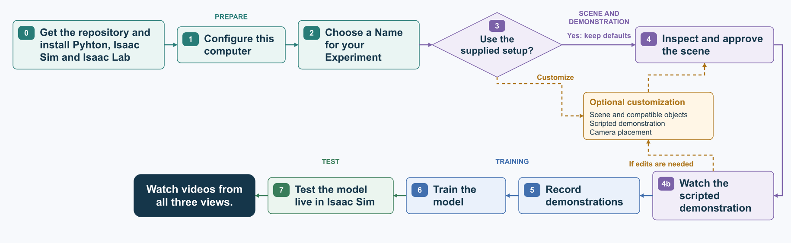
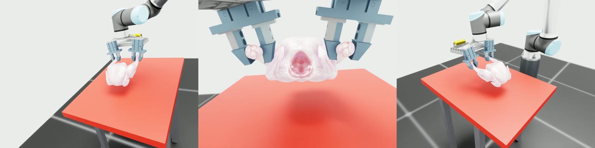
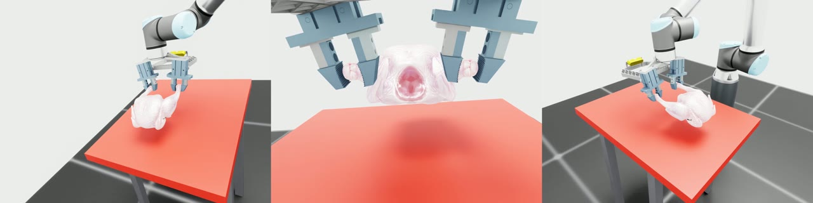

# Sim replication of ChicGrasp

This repository is a partial simulation replication of:

> Davar et al., "[ChicGrasp: Imitation-Learning-Based Customized Dual-Jaw Gripper Control for Manipulation of Delicate, Irregular Bio-Products](https://doi.org/10.1002/adrr.202500149)"

The goal is to reproduce the main learning and manipulation workflow in Isaac Lab
and NVIDIA Isaac Sim, using scripted demonstrations collected in simulation.

We thank Amirreza Davar of the University of Arkansas and his coauthors for
open-sourcing their gripper CAD, which helped make this project possible.

## What this repo does

- Load and inspect the assets, scene and camera views.
- Define, preview and record scripted demonstrations.
- Train a diffusion policy.
- Test the trained model in Isaac Sim and save videos from three different angles: LEFT, RIGHT and HAND.

Please refer to the [end-to-end tutorial](docs/TUTORIAL.md).

## Main result

The policy achieved a **60% success rate on positions excluded from training**,
with each position evaluated using three diffusion seeds. This is a simulator
learning-pipeline result, not an unassisted physical grasp or a hardware result.

### Demonstration videos

Each video shows LEFT, HAND and RIGHT views, in that order.

[Watch HC01_R1 (21.2 seconds)](docs/media/HC01_R1.mp4)

[Watch HC04_R1 (20 seconds)](docs/media/HC04_R1.mp4)

## Main files

| File | Purpose |
|---|---|
| `setup_project.py` | Detect installations and configure the computer |
| `create_experiment.py` | Create a named experiment and its output paths |
| `scene_setup.py` | Edit a compatible scene |
| `load_scene.py` | Inspect and approve the scene |
| `scripted_run.py` | Define and preview the scripted demonstration |
| `recorder.py` | Collect demonstrations |
| `train.py` | Train or resume a model |
| `live_run.py` | Test the trained model and record videos |

## What the policy learns

- **Inputs:** LEFT and RIGHT images at 320 × 240, six arm joint positions and the last open/close command for each jaw.
- **Actions:** A target tool position `(x, y, z)` in the robot's base frame and independent open/close commands for the two jaws. Wrist orientation stays fixed.
- **Camera views:** LEFT_HD and RIGHT_HD record the two fixed views at 1280 × 960. HAND moves with the gripper and is used only for video, not as a policy input.

## Citation

This simulation work is by **Bidhan Ghimire**. Please cite the original ChicGrasp
paper when using the gripper CAD or this ChicGrasp-derived work:

Amirreza Davar, Zhengtong Xu, Siavash Mahmoudi, Pouya Sohrabipour, Chaitanya Pallerla,
Yu She, Wan Shou, Philip Glen Crandall, Dongyi Wang, *Advanced Robotics Research*
2026, 0, e202500149. [https://doi.org/10.1002/adrr.202500149](https://doi.org/10.1002/adrr.202500149)

## Assets

- Chicken: Bidhan Ghimire.
- Gripper design CAD: [ChicGrasp](https://github.com/AmirrezaDavar/ChicGrasp).
- UR10e robot and ground assets: [NVIDIA Isaac Sim](https://docs.isaacsim.omniverse.nvidia.com/5.1.0/assets/usd_assets_overview.html).
